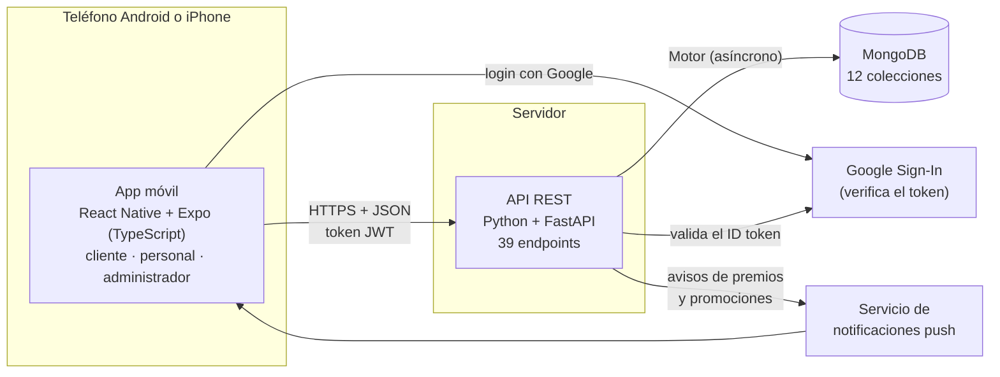

# Arquitectura de la solución

Clancy's Rewards usa una arquitectura cliente-servidor en tres capas: una app móvil, una API REST y una base de datos.



## Componentes

| Capa | Tecnología | Responsabilidad |
|---|---|---|
| App móvil | React Native, Expo, expo-router, TypeScript | Una sola app con tres grupos de pantallas según el rol: `(tabs)` para el cliente, `(staff)` para el personal y `admin` para la administración. Usa la cámara para leer el QR y guarda la sesión en almacenamiento seguro. |
| API REST | Python, FastAPI, Pydantic | Reglas del negocio: registro y login, generación y validación de QR, suma de visitas, canjes, menú, premios, promociones, personal e indicadores. Valida los datos de entrada y los permisos de cada rol. |
| Base de datos | MongoDB con el driver Motor | Guarda usuarios, membresías, visitas, QR, canjes y contenido del local. Los QR y las sesiones vencen solos con índices TTL. |
| Servicios externos | Google Sign-In, notificaciones push | Inicio de sesión con Google y avisos cuando el cliente desbloquea un premio. En iOS se suma el inicio de sesión con Apple (Sprint 2). |

## Flujo de una visita

```mermaid
sequenceDiagram
    actor C as Cliente
    participant A as App del cliente
    participant S as API
    participant D as MongoDB
    actor M as Mesero
    C->>A: Abre "Show QR Pass"
    A->>S: POST /api/qr/generate
    S->>D: Guarda token (vence en 180 s, sin usar)
    S-->>A: Token
    M->>S: POST /api/qr/scan (lee el QR)
    S->>D: Valida rol, vigencia y uso; marca el token como usado
    S->>D: Suma la visita y registra quién la validó
    S-->>M: Visita sumada
    A->>S: Consulta el estado del token
    S-->>A: Visita sumada (la pantalla del cliente cambia sola)
```

## Seguridad aplicada

- Contraseñas con bcrypt y sesiones con JWT.
- Permisos por rol en el servidor: solo el personal escanea, solo la administración edita y solo el dueño gestiona al personal.
- QR de un solo uso con vencimiento de 3 minutos, para que una foto del código no sirva después.
- Credenciales fuera del código, en variables de entorno (`backend/.env.example`).
- CORS restringido: la API solo acepta los orígenes de la variable `CORS_ORIGINS` (Sprint 1, issue #41).
- Límite de intentos: 5 logins fallidos cada 15 minutos por IP y correo, y 20 escaneos por minuto por empleado. Al pasarse, la API responde 429 con la cabecera `Retry-After` (Sprint 1, issue #42).
- 10 pruebas automatizadas con pytest comprueban el límite de intentos (`backend/tests`).

## Despliegue planificado (Sprint 2)

| Componente | Hoy | Sprint 2 |
|---|---|---|
| API | Local, en el computador de desarrollo | Render o Railway, con HTTPS, región europea |
| Base de datos | MongoDB local | MongoDB Atlas en la Unión Europea, con respaldo diario |
| Imágenes | Carpeta local del servidor | Almacenamiento de objetos |
| App Android | Expo en modo desarrollo | Build de producción con EAS y prueba cerrada en Google Play |
| App iOS | No existe aún | Build de iOS con EAS en la nube (sin Mac), TestFlight y App Store |

Los datos se alojan en la Unión Europea porque la app trata datos personales de clientes en Irlanda y debe cumplir el RGPD.
