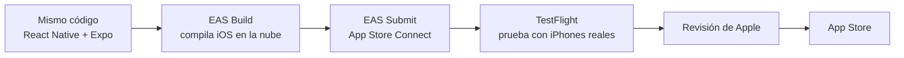

# Plan de publicación en iOS (App Store)

Ajuste del proyecto en la Fase 2, a partir de la retroalimentación docente de la Fase 1.

## Por qué se agrega iOS

El plan original publicaba solo en Google Play. En Irlanda, en septiembre de 2026, el 47,4 % de los teléfonos usa iOS y el 52,6 % Android (StatCounter, 2026). Publicar solo en Android dejaba fuera a casi la mitad de los clientes del local, así que la app se publicará en las dos tiendas.

## Cómo se hace sin un Mac

Para publicar en iOS hace falta compilar la app con las herramientas de Apple, que normalmente corren en un Mac. Como la app está hecha con Expo, la compilación se hace **en la nube con EAS Build**: los servidores de Expo compilan la versión de iOS y EAS Submit la envía a App Store Connect. No se necesita un Mac propio.

**Alternativa de respaldo:** si aparece un error propio de iOS que necesite Xcode, se arrienda un Mac en la nube por horas (MacinCloud, desde 1 USD por hora con prepago). Solo se usa si hace falta.

## Qué exige Apple

| Requisito | Qué significa para la app | Dónde queda |
|---|---|---|
| Cuenta de Apple Developer Program | 99 USD al año. Inscripción individual con cuenta de Apple con verificación en dos pasos y nombre legal | Sprint 2 |
| Inicio de sesión con Apple | Como la app ofrece login con Google, en iOS debe ofrecer también una opción equivalente que proteja la privacidad, como "Iniciar sesión con Apple" (guía 4.8) | RF-16, Sprint 2 |
| Borrado de cuenta dentro de la app | Ya estaba planificado por el RGPD | RF-15, Sprint 3 |
| Privacidad | Política de privacidad pública y etiqueta de privacidad en la ficha de App Store | RNF-08 y RNF-12, Sprint 3 |
| Permiso de cámara | Texto que explica por qué la app usa la cámara (escaneo del QR) | RNF-12, Sprint 3 |
| Notificaciones push | Clave de notificaciones de Apple (APNs), gestionada por EAS | Sprint 2 |

## Tareas agregadas al backlog

| Sprint | Tarea | Issue | Por qué va ahí |
|---|---|---|---|
| Sprint 2 | Inscripción en Apple Developer Program | [#65](https://github.com/44ndy/clancys-rewards/issues/65) | La verificación de la cuenta puede tardar; debe estar lista antes del primer build |
| Sprint 2 | HU-20: inicio de sesión con Apple | [#66](https://github.com/44ndy/clancys-rewards/issues/66) | Junto con el login con Google (HU-02), que ya estaba en este sprint |
| Sprint 2 | Build de iOS con EAS y prueba interna en TestFlight | [#67](https://github.com/44ndy/clancys-rewards/issues/67) | Al mismo tiempo que el build de Android, para probar las dos versiones desde el inicio |
| Sprint 3 | Ficha de App Store: capturas, privacidad y permisos | [#68](https://github.com/44ndy/clancys-rewards/issues/68) | Se hace junto con la política de privacidad del RGPD |
| Sprint 3 | Prueba en TestFlight con iPhones del personal y conocidos | [#69](https://github.com/44ndy/clancys-rewards/issues/69) | En paralelo a la prueba cerrada de Google Play |
| Cierre | Envío a revisión de Apple y publicación en App Store | [#70](https://github.com/44ndy/clancys-rewards/issues/70) | Junto con el paso a producción en Google Play |

Para no pasar los 13 puntos del Sprint 2, la tarea "Imágenes en almacenamiento de objetos" (#49) pasa al Sprint 3, porque no impide publicar.

## Costos

| Ítem | Costo |
|---|---|
| Apple Developer Program | 99 USD al año |
| EAS Build (Expo), plan gratuito | 0 USD (hasta 15 builds de iOS y 15 de Android al mes) |
| TestFlight | Incluido en la cuenta de Apple |
| Mac en la nube, solo si hace falta | 0 a 30 USD |
| iPhone de prueba | 0 USD (iPhones del personal y conocidos vía TestFlight) |

Con Google Play (25 USD, pago único), el hosting y el dominio, el costo total para publicar pasa de 35 a 54 USD a **134 a 183 USD**. Se cubre con el pago inicial de la propuesta comercial, y la renovación anual de Apple queda dentro de la mantención.

## Riesgos

| Riesgo | Acción |
|---|---|
| Apple rechaza la app en la revisión | Cumplir desde el Sprint 3 los requisitos de la tabla anterior y dejar margen en el cierre para un segundo envío |
| No tener un iPhone propio para probar | Probar con TestFlight en iPhones del personal y de conocidos |
| La cuenta de Apple aparece a nombre personal | Para el proyecto se usa la cuenta individual; si el local contrata la app, se puede transferir a una cuenta de su empresa |
| Que la revisión no termine antes de la entrega | Presentar la versión de TestFlight como evidencia de que la app de iOS funciona |

## Fuentes

- Apple. (s.f.). *Apple Developer Program: Enrollment*. https://developer.apple.com/programs/enroll/
- Apple. (s.f.). *App Store Review Guidelines*. https://developer.apple.com/app-store/review/guidelines/
- Expo. (s.f.). *Pricing*. https://expo.dev/pricing
- MacinCloud. (s.f.). *Pay as You Go*. https://www.macincloud.com/pages/payg.html
- StatCounter. (2026). *Mobile Operating System Market Share Ireland*. https://gs.statcounter.com/os-market-share/mobile/ireland
