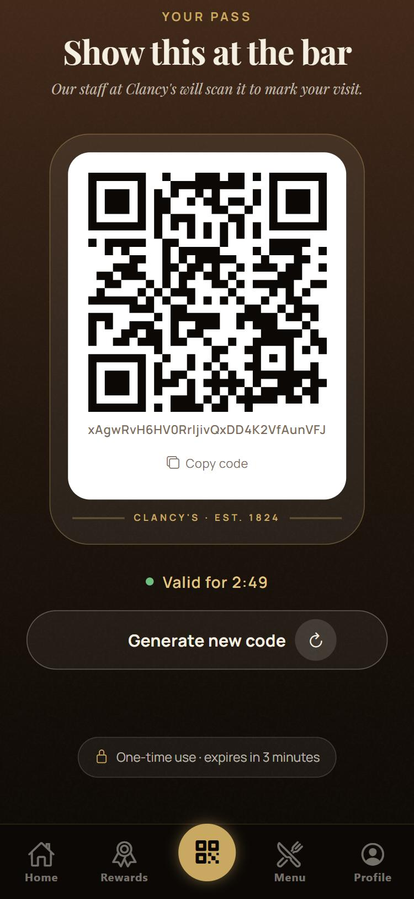
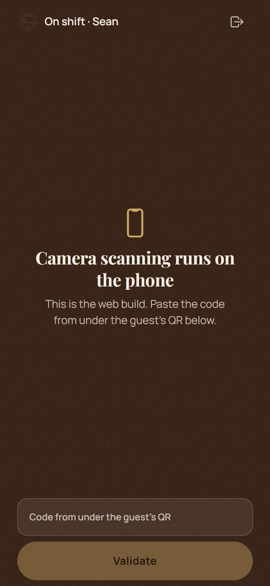
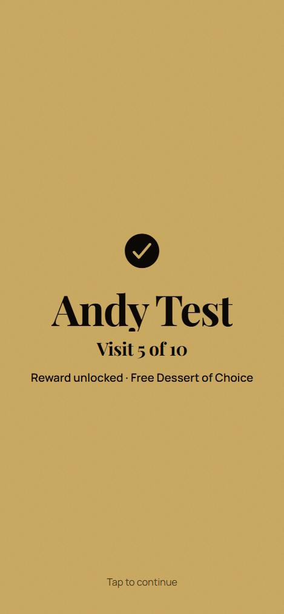
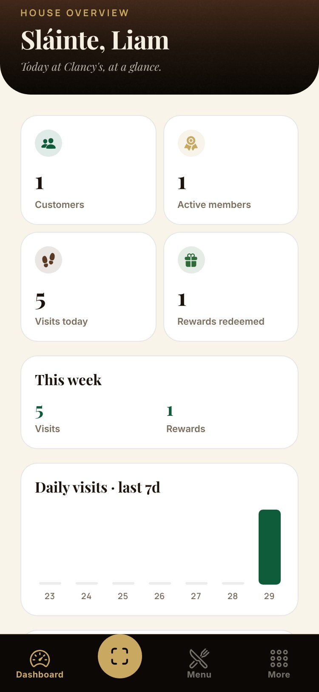

# Aplicación funcionando

Capturas del prototipo en un teléfono Android. Muestran el flujo completo de una visita y de un canje.

| # | Pantalla | Rol |
|---|---|---|
| 1 | [Bienvenida](capturas/01_Bienvenida.jpg) | Cliente |
| 2 | [Tarjeta de socio](capturas/02_Tarjeta_de_socio.jpg) | Cliente |
| 3 | [QR del cliente (3 minutos, un solo uso)](capturas/03_Pase_QR_del_cliente.jpg) | Cliente |
| 4 | [Escáner del mesero](capturas/04_Escaner_del_mesero.jpg) | Personal |
| 5 | [Visita sumada](capturas/05_Resultado_de_visita.jpg) | Personal |
| 6 | [Premios del cliente](capturas/06_Recompensas_del_cliente.jpg) | Cliente |
| 7 | [QR de canje](capturas/07_QR_de_canje.jpg) | Cliente |
| 8 | [Canje: entregar al cliente](capturas/08_Canje_-_entregar_al_cliente.jpg) | Personal |
| 9 | [Menú de la casa](capturas/09_Menu_de_la_casa.jpg) | Cliente |
| 10 | [Panel del dueño](capturas/10_Panel_del_dueno.jpg) | Administrador |

El código de la app está en `frontend/` y el de la API en `backend/`. La forma de ejecutarlo está en el README principal.
