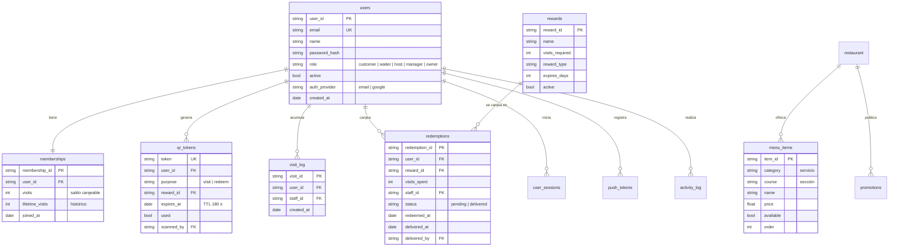

# Modelo de datos

Base de datos: MongoDB (documental). La API accede con el driver asíncrono Motor. El modelo tiene 12 colecciones. Los identificadores son cadenas con prefijo (`usr_`, `mem_`, `qr_`, `vst_`, `red_`, etc.) para que sean legibles en los registros.

## Colecciones

| Colección | Qué guarda | Índices |
|---|---|---|
| `users` | Cuentas de clientes y personal, con su rol | `email` único, `user_id` único |
| `memberships` | Visitas acumuladas de cada cliente | `user_id` único |
| `qr_tokens` | Códigos QR generados, su propósito y si ya se usaron | `token` único, `expires_at` TTL (se borran solos al vencer) |
| `visit_log` | Cada visita sumada y quién la validó | — |
| `redemptions` | Canjes de premios y su entrega en dos pasos | — |
| `rewards` | Premios configurables por el local | `visits_required` |
| `promotions` | Promociones y eventos | — |
| `menu_items` | Menú real del local (43 platos) | compuesto `category` + `order` |
| `restaurant` | Datos del local | — |
| `user_sessions` | Sesiones con token opaco, heredadas de la primera versión; hoy el login usa JWT y esta colección queda pendiente de revisión | `session_token` único, `expires_at` TTL |
| `push_tokens` | Dispositivos registrados para notificaciones | — |
| `activity_log` | Registro de acciones del personal y la administración | `created_at` descendente |

## Decisiones de diseño

- **Saldo e histórico separados.** `visits` baja al canjear un premio; `lifetime_visits` nunca baja. Así el local puede ver la fidelidad real de un cliente aunque canjee.
- **Vencimiento en la base de datos.** Los QR y las sesiones usan índices TTL: MongoDB los elimina solo, sin tareas programadas.
- **Trazabilidad.** Cada visita y cada canje guardan el `staff_id` de quien lo validó, lo que permite auditar al personal.
- **Contenido como datos.** El menú, los premios y las promociones son documentos editables desde el panel, no código. El menú inicial se carga desde `backend/data/menu.clancys-cork.json`.
- **Escalable a más locales.** El modelo parte con un local; agregar un campo de local a las colecciones de contenido y visitas permite crecer a otros bares sin cambiar la estructura general.

El esquema sale directamente del código en `backend/server.py` (función `startup` para los índices).
