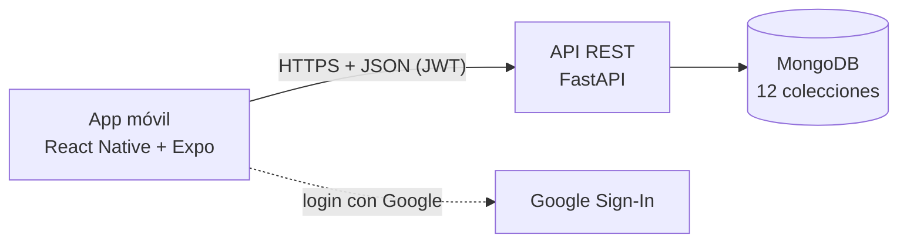

# Clancy's Rewards

Aplicación móvil de fidelización de clientes para Clancy's Cork, un pub y restaurante en el centro de Cork, Irlanda. Se publicará en Google Play y en App Store. El cliente acumula visitas mostrando un código QR que el personal escanea, y canjea premios al llegar a la meta. La administración gestiona el menú, los premios y las promociones desde la misma app, y revisa indicadores de sus clientes.

Proyecto Capstone (PTY4614, sección 001V), Ingeniería en Informática, Duoc UC San Bernardo.

## Integrante y roles

| Integrante | Roles |
|---|---|
| Andy Aravena Auquilen | Product Owner, Scrum Master y desarrollador (proyecto individual) |

La administración del local participa como referente del negocio para validar requerimientos y avances.

## Tecnologías

| Capa | Tecnología |
|---|---|
| App móvil | React Native con Expo (TypeScript) y expo-router, para Android e iOS |
| API | Python con FastAPI |
| Base de datos | MongoDB (driver Motor) |
| Autenticación | Correo y contraseña (bcrypt + JWT) e inicio de sesión con Google |
| Compilación y publicación | EAS Build y EAS Submit (Expo): builds en la nube para Android e iOS, sin Mac |
| Gestión | GitHub: issues, milestones y etiquetas |

## Arquitectura

Arquitectura cliente-servidor en tres capas. El detalle está en [Arquitectura](Fase%202/Evidencias%20de%20documentaci%C3%B3n/Arquitectura.md) y el modelo de datos en [Modelo de datos](Fase%202/Evidencias%20de%20sistema/Base%20de%20datos/Modelo_de_datos.md).



## Metodología

Se usa Scrum en sprints de dos semanas, porque permite entregar avances funcionales, recibir retroalimentación de la docente y del local en cada revisión, y ajustar el sprint siguiente. El backlog se ordena dejando primero lo que impide publicar la app (seguridad y despliegue), después lo que afecta al usuario y al final lo visual. Cada sprint es un [milestone](https://github.com/44ndy/clancys-rewards/milestones) y cada tarea un issue. Más detalle en [Metodología y backlog](Fase%202/Evidencias%20de%20documentaci%C3%B3n/Metodologia_y_backlog.md).

| Sprint | Fechas (2026) | Meta | Estado |
|---|---|---|---|
| Sprint 0 | 19 – 23 oct | Configuración | Completado |
| Sprint 1 | 26 oct – 6 nov | Seguro y confiable | En curso |
| Sprint 2 | 9 – 20 nov | En la nube, Android e iOS | No iniciado |
| Sprint 3 | 23 nov – 4 dic | Privacidad y control | No iniciado |
| Cierre | 7 – 11 dic | Producción y entrega | No iniciado |

## Cómo ejecutarlo localmente

Requisitos: Python 3.11 o superior, Node.js 20 o superior, MongoDB y la app Expo Go en un teléfono Android.

**Backend**

```bash
cd backend
pip install -r requirements.txt
cp .env.example .env        # completar los valores (MongoDB, JWT, cuentas iniciales y CORS_ORIGINS)
uvicorn server:app --host 0.0.0.0 --port 8001
```

**Pruebas del backend**

```bash
cd backend
pip install -r requirements-dev.txt
pytest
```

Las pruebas crean una base de datos temporal en MongoDB, así que no tocan los datos reales.

**App**

```bash
cd frontend
yarn install
cp .env.example .env        # EXPO_PUBLIC_BACKEND_URL con la IP del computador, por ejemplo http://192.168.1.10:8001
npx expo start
```

Luego se escanea el QR de Expo con el teléfono. La primera vez que arranca, el backend crea las cuentas de dueño, encargado y mesero con las contraseñas definidas en el `.env`, y carga el menú real del local.

## Estructura del repositorio

```
clancys-rewards/
├── frontend/                          App móvil (React Native + Expo)
├── backend/                           API (FastAPI) y datos del menú
├── Fase 1/
│   ├── Evidencias Individuales/       1.1 Autoevaluación de competencias, 1.2 Diario, 1.3 Autoevaluación
│   └── Evidencias Grupales/           1.4 Formativa, 1.5 Definición del proyecto, presentación, Carta Gantt y planilla
├── Fase 2/
│   ├── Evidencias Individuales/       2.1 Diario de reflexión, 2.2 Autoevaluación de avance
│   ├── Evidencias Grupales/           2.3 Formativa, 2.4 Informe de avance y planillas
│   ├── Evidencias Proyecto/           Presentación del avance
│   ├── Evidencias de documentación/   Matriz de requisitos (Excel), arquitectura, metodología y backlog
│   └── Evidencias de sistema/
│       ├── Aplicación/                Capturas de la app funcionando
│       └── Base de datos/             Modelo de datos
└── Fase 3/                            Presentación final (se completa al cierre)
```

## Evidencias por fase

| Fase | Documento | Ubicación |
|---|---|---|
| 1 | Autoevaluación de competencias, diario y autoevaluación | `Fase 1/Evidencias Individuales/` |
| 1 | Definición del Proyecto APT, presentación y Carta Gantt | `Fase 1/Evidencias Grupales/` |
| 2 | Informe de avance (guía 2.4) | `Fase 2/Evidencias Grupales/` |
| 2 | Diario de reflexión y autoevaluación de avance | `Fase 2/Evidencias Individuales/` |
| 2 | Matriz de requisitos (Excel), arquitectura, metodología y plan de publicación en iOS | `Fase 2/Evidencias de documentación/` |
| 2 | Capturas de la app y modelo de datos | `Fase 2/Evidencias de sistema/` |
| 2 | Presentación del avance | `Fase 2/Evidencias Proyecto/` |

La Carta Gantt se abre en [onlinegantt.com](https://www.onlinegantt.com) con la opción "Open .gantt file".
